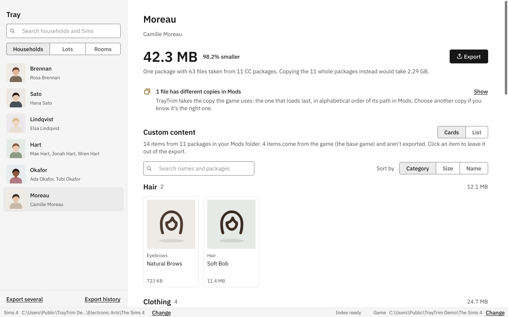
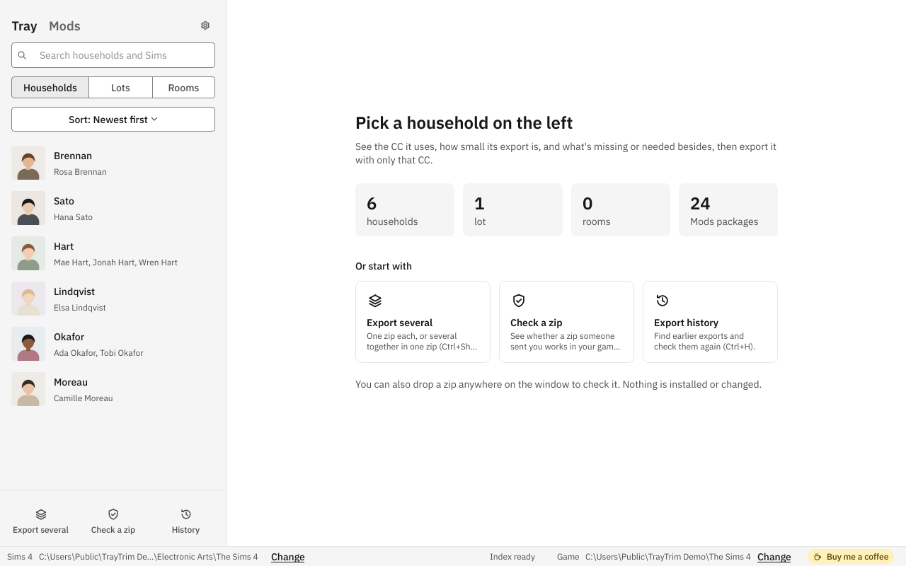
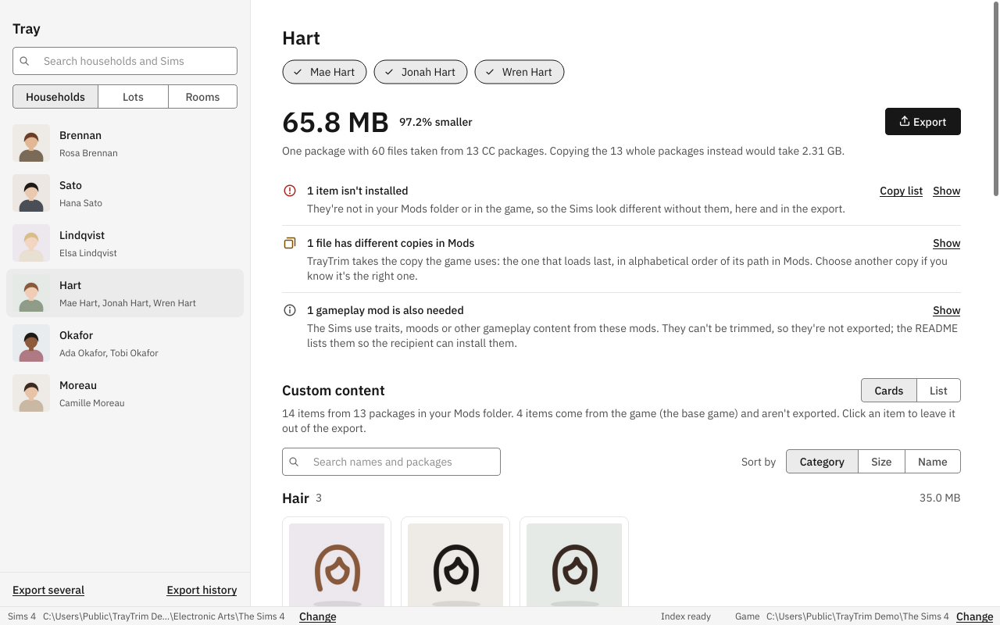
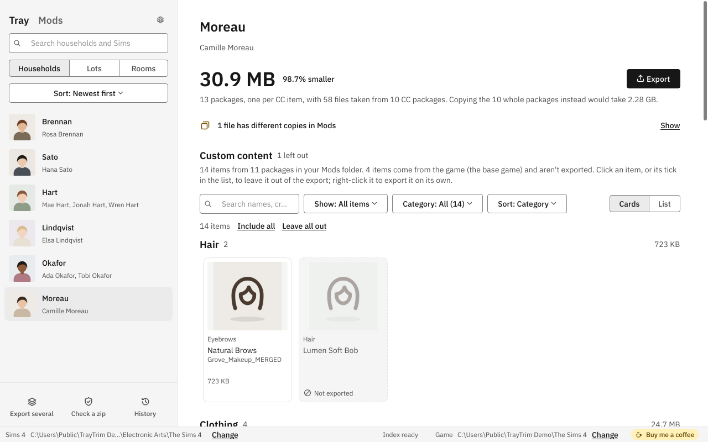
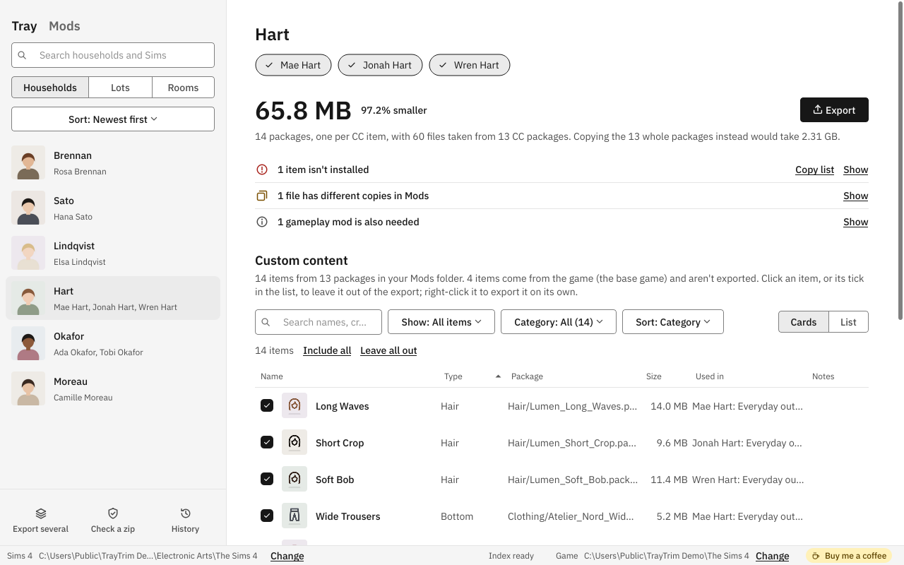
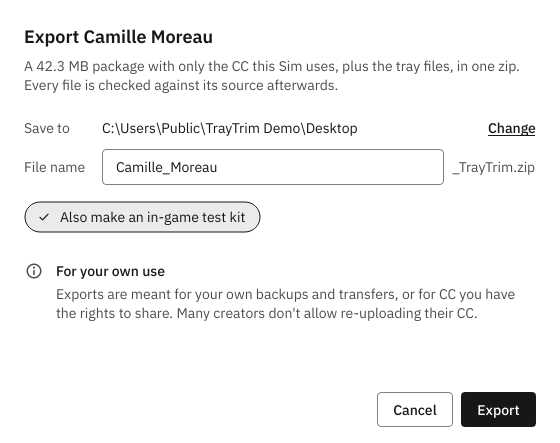
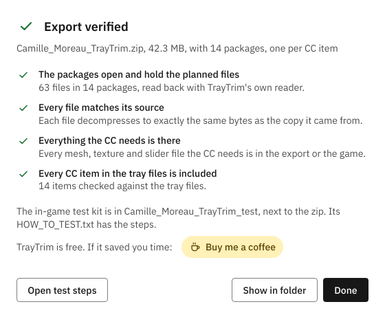
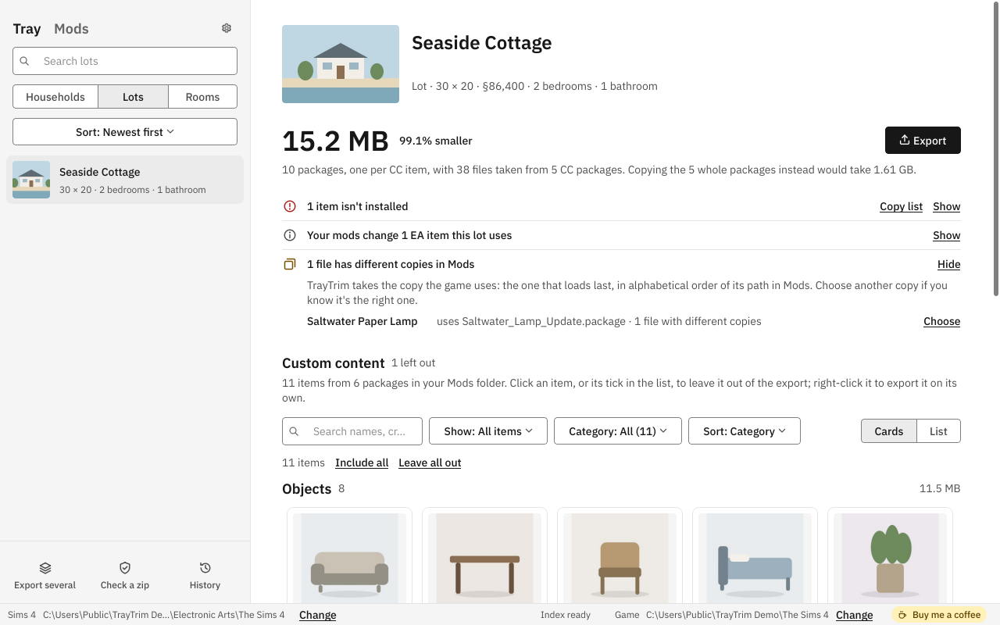
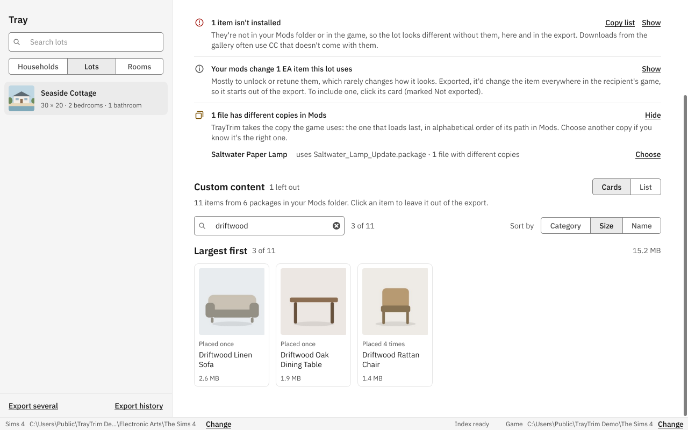
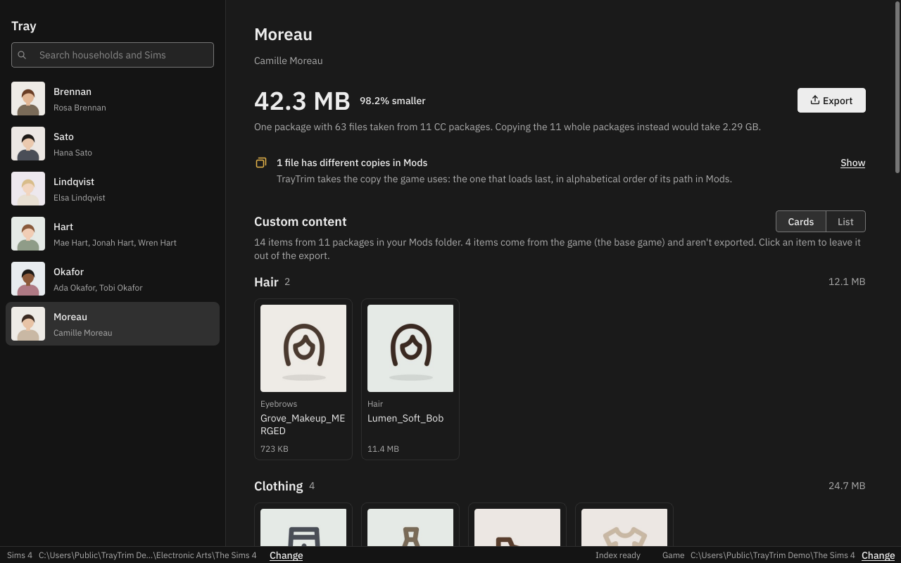

<p align="center">
  
</p>

<h1 align="center">TrayTrim</h1>

<p align="center">
  Export a Sims 4 household, lot or room with only the custom content it actually uses.<br>
  A small package per CC item, checked file by file, instead of gigabytes of whole packages.
</p>

<p align="center">
  <a href="https://buymeacoffee.com/stixe"></a>
</p>

<p align="center">
  
</p>

## Why

Tray importers export a Sim "with CC" by copying every package that contains something the Sim
uses. With merged packages that adds up fast: one lipstick from a 1 GB merge brings the whole
gigabyte along. On a real Mods folder with 4,500 packages, one single-Sim household came to
4.96 GB that way. TrayTrim exported the same Sim in 30.5 MB.

TrayTrim reads the tray files, works out exactly which resources are needed (for Sims: CAS
parts, meshes, textures, thumbnails, sliders, sculpts, skin tones; for lots and rooms: objects,
their models and textures, walls, floors and other build items), copies just those out of whatever
packages they live in, writes them into one package per CC item next to the tray files, each
named the way its creator named it (`Nivelle_yfTop_HalterBackZip_SolidBlack_TT.package`), and checks
the result. The zip holds the packages, the tray files and a README that says how to install it.

## What it does

- **Finds every CC item** the Sims wear, in every outfit, plus genetics, sliders, sculpts and skin
  tone, straight from the tray files.
- **Does lots and rooms too**: every placed object and every wall, floor, fence or other build
  item. Mods that only change EA objects (unlocks, tuning) are left out unless you include them,
  so an export doesn't change the recipient's game.
- **Follows every file the CC needs**: meshes, textures in any format, thumbnails, slider shapes,
  across packages, so recolors that need a separate mesh still work.
- **Takes the copy the game uses** when the same file is in your Mods more than once with
  different content, tells you which one and why, and lets you pick another.
- **Shows what everything is**: CC by its own name ("Driftwood Rattan Chair", "Soft Bob"), with
  its thumbnail, searchable, filterable (by category, what's left out, items with several copies) and
  sortable by category, name, size or package, as cards or a list. Lots, rooms and households
  show their own tray picture.
- **Lets you leave things out** with a click, or all of them at once (Include all, Leave all out,
  for what the search matches), and export only some Sims of a household. The size updates as
  you go.
- **Never copies game content.** Items from the base game and packs stay out; the export's README
  lists the packs it needs.
- **Checks every export**: the packages reopen, every file decompresses to the same bytes as its
  source and is in one package only, everything the CC refers to is there, every CC item is
  included.
- **Says what it can't trim**: gameplay mods (traits, moods, careers) the Sims depend on are listed in
  the export's README, and default replacements in the app before you export.
- **Prepares an in-game test**: a folder with only the export and steps to try it in your game
  with nothing else installed, then put your Mods back.
- **Exports several at once**, one verified zip each, or together in one zip that shares its
  packages, like a lot with the household that lives there; search and filter what to pick. A
  history keeps your last 200 exports.
- **Settings** (the gear, or Ctrl+,): light or dark theme, the folders, where exports go and
  whether they make a test kit, update checks, and what TrayTrim keeps in its cache.
- **Exports one item on its own**: right-click any CC item for a small package with just that
  item and everything it needs, even when it lives in a 1 GB merge.
- **Shows what breaks if you delete a package** (the Mods tab): which other CC needs its meshes
  or textures, directly or through another package, which households, lots and rooms use it, and
  which of its files never load because a later package replaces them.
- **Checks a zip before you install it**: open or drop any zip with tray files and packages (a
  TrayTrim export or not) to see whether it's intact, which packs it needs that you don't have,
  and which of its CC you already have, and whose copy the game would use.

<table>
  <tr>
    <td></td>
    <td></td>
  </tr>
  <tr>
    <td></td>
    <td></td>
  </tr>
  <tr>
    <td></td>
    <td></td>
  </tr>
  <tr>
    <td></td>
    <td></td>
  </tr>
  <tr>
    <td colspan="2"></td>
  </tr>
</table>

<sub>Screenshots use invented households, an invented lot and invented CC.</sub>

## Download

**Windows:** get `TrayTrim-<version>-setup.exe` from the
[Releases](https://github.com/stixez/TrayTrim/releases) page. It installs for your user only, no
administrator rights needed, and uninstalls from Windows Settings. A portable zip is there too.
The installer isn't code-signed yet, so SmartScreen may say it comes from an unknown publisher:
choose More info, then Run anyway.

**macOS (Apple silicon):** get `TrayTrim-<version>-macos-arm64.zip`, unzip it and move TrayTrim
to Applications. The app isn't signed by Apple yet, so the first time, right-click it and choose
Open. On an Intel Mac, run it from source (below).

**Linux (x86-64):** get `TrayTrim-<version>-linux-x86_64.tar.gz`, unpack it and run
`TrayTrim/TrayTrim`. It finds the Sims 4 folders inside Proton's prefix (in any Steam library,
including one on another drive or an SD card) and in Lutris, Bottles and Heroic prefixes; if it
doesn't, choose them in the status bar.

The Windows build is tested on a real Sims 4 install; the macOS and Linux builds are built and
started on each release by CI, but haven't been tried with the game yet. Reports are welcome.

## Safety

TrayTrim only **reads** your Sims 4 folders, the Mods tab and Check a zip included. It never
writes, moves, renames or deletes anything in Mods or Tray, your saves, the game install, or
Sims 4 Studio's folder, and it refuses to save an export inside any of them. Exports go to a
folder you choose (your Desktop by default); TrayTrim's own index and settings live in its cache
and config folders.

The optional in-game test kit is the one thing that touches Mods, and only when you run it
yourself: its steps (or the two `.bat` helpers on Windows) rename your Mods folder for the test and
put it back afterwards. The helpers refuse to run while the game is open and only restore Mods if
the test folder holds nothing but the files the test put there.

**Updates:** at start, TrayTrim asks GitHub (`api.github.com`) whether a newer release is out, and
if one is, offers its download; nothing is downloaded or installed unless you choose to. The
request carries nothing about you or your files. Turn it off in Settings (or set the environment
variable `TRAYTRIM_NO_UPDATE_CHECK=1`).

## How it works

**Tray files** are the game's own protobuf messages. Their schemas ship with The Sims 4 (compiled
into `Game/Bin/Python/generated.zip`), and the outfit and body type enums come from the game's Python
code; [`tray.py`](src/traytrim/tray.py) lists every field used. The small headers around the
messages were worked out from real files and checked against every household in a real Tray folder.
Lot and room files are snappy-compressed; their layout follows
[Harbor](https://github.com/Harborofficial/Harbor)'s description and was checked on every lot and
room in a real Tray folder.

**The index** of your Mods and of the game (base game, packs and their Delta updates) lives in
TrayTrim's cache folder. Only packages that changed are read again, so after the first build (about
a minute for a large Mods folder) a refresh takes about a second. Packages deeper than
`Mods/Resource.cfg` allows are skipped, like the game does.

**Dependencies:** a CAS part's key list and a mesh's texture list are read directly (their layout
was checked on thousands of real resources). Sliders, sculpts and other small resources are scanned
for the ids of resources in their own package; object definitions and models are also matched
against models and textures in other packages, so a recolor finds its mesh. Textures are matched
across texture formats, the way the game resolves them.

**What needs what** (the Mods tab) is a second cache next to the index: every reference between
Mods resources, found the way an export follows them. The first build reads every CAS part, mesh
and object in Mods, so it takes a few minutes on a big folder (about four for 4,500 packages and
43 GB); after that only changed packages are read, in about a second. Only the copies the game loads count, and references are followed through any number of
packages, both for "what breaks" and for "used by".

**One assumption the game doesn't document:** when two Mods packages hold the same resource, the
game uses the one that loads last, and packages load in alphabetical order of their path in Mods.
Conflict notices say so.

## Limitations

- Changes that affect every Sim and aren't referenced from the tray files can't be found: default
  replacements of skin, eyes or bodies that the Sims don't wear directly, and script mods. The
  recipient needs those separately.
- Sims living on a lot aren't part of a lot export; export the lot and their household together.
- CC names (string tables) aren't exported; CAS shows the items without them.
- The Mods tab checks the Tray only: Sims, lots and rooms that exist only in a save game aren't
  counted in "used by".
- Many CC creators don't allow re-uploading their work. Exports are meant for your own backups and
  transfers, or for CC you have the rights to share.

## Command line

Everything the app does is also available from a terminal:

```
traytrim                    # open the app
traytrim tray list --all    # households, lots and rooms in your Tray folder
traytrim tray show "Camille" --plan
traytrim export "Camille" --out ./exports
traytrim check ./exports/Camille_Moreau_TrayTrim.zip
traytrim index              # build or refresh the index
traytrim which 034AEECB:80000000:85C005D0625B6DAB
traytrim info Some.package --list --verify
```

## Run from source

Needs Python 3.12 or newer (CI tests 3.12).

```
git clone https://github.com/stixez/TrayTrim
cd TrayTrim
python -m venv .venv
.venv\Scripts\activate            # macOS / Linux: source .venv/bin/activate
pip install -e ".[gui,dev]"
python -m traytrim
pytest
ruff check src tests packaging
```

Build the app and the Windows installer with `pip install -e ".[gui,build]"` and
`python packaging/build.py` (the installer needs [Inno Setup 6](https://jrsoftware.org/isinfo.php)).

## Contributing

Bug reports and pull requests are welcome. Three rules keep TrayTrim trustworthy:

- Nothing may write to the Sims 4 folders (Mods, Tray, saves), the game or Sims 4 Studio's folder.
- Formats aren't guessed: every resource type, field or layout has a source noted next to it (the
  game's own schemas, Sims 4 Toolkit, or a check on real files), and unverified results are marked
  approximate.
- No real CC, game or tray files in the repo; tests build small synthetic ones. `pytest` runs on
  Windows, macOS and Linux in CI.

CI also runs `ruff check src tests packaging` (the rules are in `pyproject.toml`). More in
[CONTRIBUTING.md](CONTRIBUTING.md); UI changes follow [docs/DESIGN.md](docs/DESIGN.md). Found a
security problem? See [SECURITY.md](SECURITY.md).

## Support

TrayTrim is free and open source. If it saves you time, you can
[buy me a coffee](https://buymeacoffee.com/stixe).

## License and credits

TrayTrim is released under the [MIT License](LICENSE).

It uses [PySide6](https://doc.qt.io/qtforpython/) (Qt for Python, LGPL) and bundles the
[IBM Plex](https://github.com/IBM/plex) fonts (SIL Open Font License, see
`src/traytrim/gui/assets/fonts/OFL.txt`). Resource type ids were cross-checked with
[Sims 4 Toolkit](https://github.com/sims4toolkit), s4pi-reforged and TS4Tools; the lot and room
layouts come from [Harbor](https://github.com/Harborofficial/Harbor) (MIT). The snappy decoder is
written from Google's [format description](https://github.com/google/snappy). The licenses of
everything the app bundles are in [THIRD_PARTY_NOTICES.md](THIRD_PARTY_NOTICES.md), and ship with
the app.

TrayTrim is a fan-made tool and isn't affiliated with or endorsed by Electronic Arts or Maxis. The
Sims is a trademark of Electronic Arts Inc.
